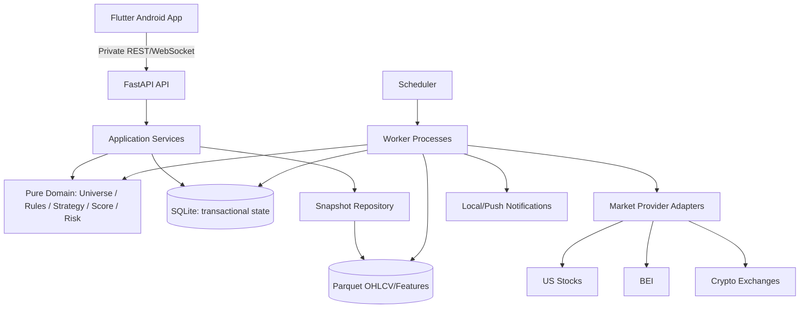

# ARCHITECTURE — Modular Monolith + Workers

**Status:** LOCKED base stack, implementation decisions revisable via ADR.

## System overview

## Technology decisions

| Layer | Choice | Rationale |
|---|---|---|
| Mobile | Flutter + Dart, feature-first folders | One maintainable Android app, optional iOS |
| Backend | Python + FastAPI + Pydantic | Native quantitative ecosystem, schema validation |
| Domain | Pure typed Python services | Same logic for screening/backtesting/live |
| Transactions | SQLite WAL, migration tooling | Single-user local, atomic transactions |
| Historical data | Partitioned Parquet + DuckDB | Efficient research scans and compression |
| Jobs | Simple durable job registry + worker/scheduler | Avoid Celery/Kafka until justified |
| Network | loopback/private VPN or access proxy | Never anonymous public API |
| Notifications | Local notifications first; push bridge as optional | Minimize dependencies for solo app |

**Concurrency:** SQLite has single-writer behavior; serialize writes via repository/worker, WAL and busy timeout. Workers write Parquet via temp file + atomic rename, then publish committed snapshot metadata in SQLite. Readers only inspect committed manifests; never partially written files. Avoid two schedulers executing same task; use lease/unique job key.

## Backend boundaries / ports

- `domain/`: deterministic rule AST, indicators, strategies, market-agnostic interfaces, sizing; **no** FastAPI/IO/vendor imports.
- `application/`: use cases `RunScreener`, `BuildUniverse`, `EvaluateEligibility`, `RecordPaperTrade`, `PublishSnapshot`.
- `ports/`: `MarketDataProvider`, `InstrumentDirectory`, `QuoteProvider`, `FeatureStore`, `NotificationGateway`, `Clock`, `Calendar`.
- `infrastructure/`: Yahoo, Binance, SEC, market-calendar, SQLite/Parquet adapters, networking.
- `api/`: Pydantic, auth, pagination, error DTOs; thin handlers only.
- `workers/`: idempotent ingestion, QC, feature compute, scan, alerts; no business rules duplicated.

## Consistency and immutable snapshots

- Raw ingest preserved with checksum + provider version.
- `DataSnapshot` points to immutable partition manifests. `ScreenerRun` stores `strategy_version`, config hash, data snapshot ID, code revision, `evaluated_at` and complete exclusion counts.
- Signal snapshots append-only. Current status derives from events; never update original published evidence.
- UI uses latest **committed** run; never mix features from uncommitted data pulls.

## Event pipeline

1. Market-calendar scheduler waits until final candle expected, then provider-specific settlement buffer.
2. Retrieve as-of records; validate completeness and timezone.
3. Commit canonical candles (idempotent upsert semantics for correction revisions).
4. Compute indicators only from finalized candles; persist versioned feature snapshot.
5. Universe filter → strategy candidates → score → risk/eligibility → snapshot & audit.
6. Dedupe notifications by immutable event key; publish status/freshness to UI.
7. Record observations and outcomes later through separate evaluator.

**Do not** rerun whole-market feature computation on every Flutter page load. Mobile reads cache/snapshot and requests explicit refresh when needed.

## Deployment modes

- **Local dev:** API on 127.0.0.1, SQLite + Parquet in local data dir, Flutter emulator, mock provider fixture.
- **Private device:** API on home PC/mini-server, reachable only via Tailscale or authenticated private tunnel; **do not bind unauthenticated 0.0.0.0**.
- **Optional VPS:** only after threat model/ops controls ready; secrets encrypted at rest, HTTPS/VPN, firewall, monitoring and backup.

## Planned performance

No invented throughput SLOs. Measure: daily ingestion duration, universe size, scan latency, API p95 for cached lists, mobile startup/render time, data freshness and provider failures. Establish actual target only after representative dataset (~100 initial assets, then expand).

## ADR trigger

Create decision entry if changing database, data origin, calendar convention, strategy semantics, score weights, auth boundary, trade-execution scope, or forecast gating.
