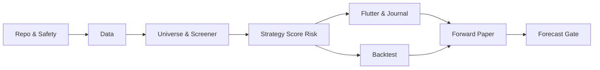

# ROADMAP — Milestone-Based Delivery

**Status:** planned. No promised dates, no falsely fixed effort estimates. Sequence is dependency-driven. Each milestone has concrete exit gate; do not skip M1 data quality to jump to ML UI.

## M0 — Repository & safety foundation

**Deliverables:** monorepo scaffold Flutter/FastAPI, tooling pinned, CI, typed domain package, clean architecture ports, SQLite migrations, sample fixtures, private network default, secret-free examples.

**Exit:** lint/typing/unit skeleton pass; API protected by auth design; backup/restore rehearsal on fixture; no raw key in git. See `TSK-001..005`.

## M1 — Canonical data foundation

**Deliverables:** instrument registry + alias history, calendar engine, provider adapters, raw/adjusted & final candle handling, Parquet manifests and QC dashboard, 10–20 symbol pilot per market.

**Exit:** T-001..005, T-021 pass; provider outage yields STALE/UNKNOWN; dataset coverage findings documented. Don't expand universe until provider validation.

## M2 — Universe & screener

**Deliverables:** Liquid Universe gates, exclusion reasons, initial technical features, typed AND/OR/NOT rule builder backend, saved/versioned screens, FastAPI browse endpoints.

**Exit:** no unknown quote can yield execution verified; stable point-in-time runs, T-004/008/009. All errors visible.

## M3 — Strategy, score and risk

**Deliverables:** Pullback/Breakout deterministic detectors, score breakdown, market-specific ranks, trade eligibility, entry/stop/target and position sizing.

**Exit:** golden fixtures, same-bar/next-open/gap semantics tested; tick/lot/order rules pass T-006/007/010..014/029/030.

## M4 — Flutter private app + journal

**Deliverables:** Home, Explore, custom builder, Asset Intelligence, watchlist and event alerts, journal, Data Health screen.

**Exit:** end-to-end scan → inspect → add watch → record manual/paper trade, offline/stale + screen reader tests pass, auth negative test pass.

## M5 — Backtest and historical audit

**Deliverables:** immutable signal ledger, versioned runs, deterministic replay/backtester with costs, baseline comparison, universe/survivorship caveats, metrics and CSV exports.

**Exit:** T-016..018/026 pass; OOS protocol signed off; no hidden optimistic fill behavior.

## M6 — Forward paper validation

**Deliverables:** scheduled EOD scans, append-only paper signals, actual outcome tracking and reliability dashboard. Run through diverse market conditions before considering decision upgrades.

**Exit:** stability, failure/recovery, data quality and source-lag trends documented. No required target ROI or win rate fabricated.

## M7 — Advanced forecasting (GATED) and polish

**Deliverables:** research baseline, ML experiment registry, calibration + time split audit, forecast panel **only after** explicit manual validation. Optional quote streaming, events and improved mobile UX.

**Exit:** [PREDICTION_VALIDATION](PREDICTION_VALIDATION.md) gates passed. If model fails, ship app without numeric probabilities; that's a successful safety decision.

## Priority rules

Resolve blockers in order: **data availability → valid signals → risk math → user interface → measured prediction**. Refuse feature creep that makes baseline unfalsifiable. Add P1 only when P0 reliable.

## Milestone dependencies

**Next engineering action:** `TSK-001` scaffold, then `TSK-002`, `TSK-003`. See [TASKS](TASKS.md).
